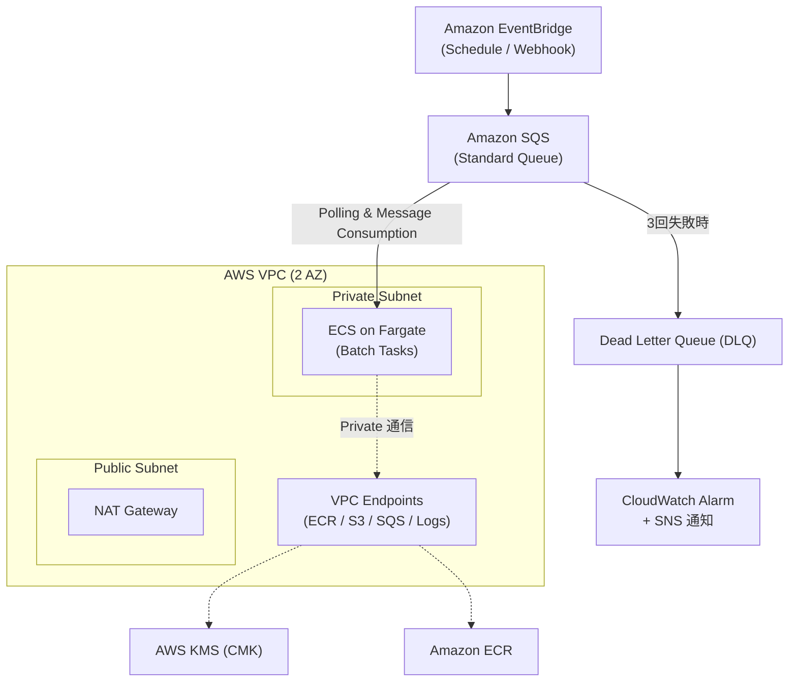

# Event-Driven Batch Forge

> サーバーレス＆イベント駆動で紡ぎ出す、高耐障害バッチオーケストレーション基盤

---

## 📖 プロジェクト概要

本プロジェクトは、**「EventBridge × SQS × ECS (AWS Fargate)」** を軸とした本番対応の堅牢なイベント駆動型バッチ処理システムです。

静的で長期運用されるネットワークや暗号化キー、コンテナレジストリは **Terraform** で堅牢に固め、変化の速いバッチワークフローやキューイング設計は **AWS CDK (TypeScript)** で俊敏に組み上げる――IaCの二刀流アプローチを採用し、両者は **AWS Systems Manager (SSM) Parameter Store** を通じて疎結合に連携します。

### 🌟 コアバリュー
- **完全閉域網のセキュリティ設計**: ECSタスクはPrivate Subnetに配置し、AWS PrivateLink (VPCエンドポイント) 経由で安全に通信。
- **ポイズンピル・耐久性**: SQSのDead Letter Queue (DLQ) とCloudWatchアラートによる自動リトライおよび異常検知。
- **疎結合アーキテクチャ**: TerraformとAWS CDKのライフサイクルをSSM Parameter Storeで分離し、パイプラインの独立性を確保。

---

## 🏗️ インフラアーキテクチャ



---

## 📂 ディレクトリ構成

```text
.
├── terraform/               # 静的基盤レイヤー (Network, Security, ECR)
│   ├── main.tf
│   ├── vpc.tf
│   ├── kms.tf
│   ├── iam.tf
│   └── outputs_ssm.tf      # CDKへ渡すパラメータをSSMに書き出し
│
├── cdk/                     # 動的・アプリ連動レイヤー (SQS, EventBridge, ECS)
│   ├── bin/
│   │   └── batch-app.ts
│   ├── lib/
│   │   └── batch-stack.ts  # SSMからTerraform管理のリソースARNを参照
│   ├── package.json
│   └── tsconfig.json
│
└── README.md
```

---

## 🚀 デプロイ手順

### ステップ 1: 基盤リソースのデプロイ (Terraform)
まずはVPC、KMSキー、IAMロール、ECRをTerraformで展開し、SSM Parameter Storeにリソース情報を登録します。

```bash
cd terraform
terraform init
terraform plan
terraform apply
cd ..
```

### ステップ 2: ワークロードのデプロイ (AWS CDK)
TerraformによってSSMに保存されたパラメータを動的に読み取り、SQSやECSタスク、EventBridgeを展開します。

```bash
cd cdk
npm install
npm run build
npx cdk synth
npx cdk deploy
```

---

## 🎭 キャスト & クレジット（AIアプリ工場劇場）

幕が下りるその瞬間まで、情熱を込めて創り上げられた本インフラの製作陣をご紹介します。

- **agent🔵 (企画・要件定義)**: システムの全体アーキテクチャを描き出し、実用性と堅牢性を両立する二刀流IaC構想を策定した演出プランナー。
- **agent🍇 (アーキテクチャ設計)**: ネットワーク境界、KMSエンベロープ暗号化、SSMパラメータ連携の精緻な青写真を引いた構造設計士。
- **agent🍊 (実装)**: TerraformとCDKのコードを爆速かつ丹精込めて組み上げたクラフトマン。
- **agent🟢 (品質管理・レビュー)**: 最小特権の原則、DLQリトライポリシー、IaCの構文整合性を妥協なく磨き上げた品質の守護者。
- **agent🟡 (プロデューサー)**: 全工程を束ね、劇場をひとつに結びつけてこのリポジトリを世に解き放った総指揮。

*Produced by AI App Factory Theater.*